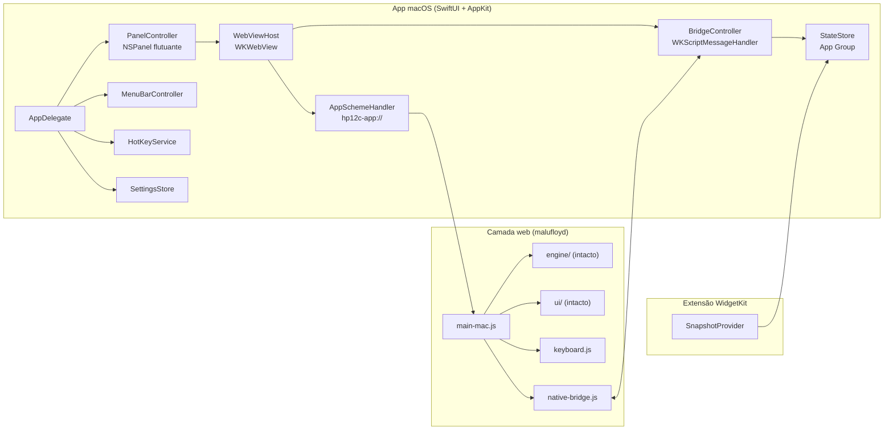

# Arquitetura do 12c Widget para macOS

> Documento vivo. Base: malufloyd/hp12c, commit `f1c12e80a9c14757c8bf406386f7ced1f405c3a9` (16/10/2026), uso autorizado pelo Professor Cecílio em 01/11/2026 (DEC-001). Decisões formais em `docs/DECISIONS.md`; fases em `docs/MASTER-PLAN.md`.

# 1 Diagnóstico do código de origem

## 1.1 O que aproveitamos sem mudança

A leitura do código mostra uma separação boa para o nosso caso. A pasta `src/engine/` (cerca de 1.460 linhas) contém o motor inteiro e não toca no DOM: a classe `Calculator` recebe códigos de tecla por `press(code)` e `release()`, expõe o visor por `display` e se serializa por `serialize()` e `Calculator.deserialize()`. A pasta `src/ui/` desenha a calculadora em SVG (viewBox de 1280 × 790) e traduz cliques em códigos de tecla. As duas camadas entram no app como estão, junto com `vendor/decimal.mjs` e os 200 testes.

## 1.2 O que precisa de adaptação

Encontramos quatro pontos em que o código foi pensado para o iPhone e não para o Mac.

O primeiro é o teclado físico: não há nenhum tratamento de teclas, só de toque e ponteiro. No Mac isso é indispensável. O segundo é a persistência: `main.js` grava em `localStorage`, que em um WKWebView carregado de arquivo local não é confiável e, além disso, ficaria invisível para o widget. A boa notícia é que `load(storage)` e `save(storage, calc)` já recebem o armazenamento como parâmetro, de modo que basta injetar um adaptador nativo. O terceiro é o carregamento: o projeto usa módulos ES, que o WebKit costuma bloquear quando a página vem de `file://`; vamos servir os arquivos por um esquema próprio. O quarto são os detalhes de celular (rotação, áreas seguras do iPhone, service worker, fundo preto), que precisam ser neutralizados ou trocados por fundo transparente.

Em síntese, o motor e o desenho ficam intactos; o trabalho se concentra em um novo ponto de entrada (`main-mac.js`), em dois módulos pequenos (teclado e ponte nativa) e no invólucro em Swift.

# 2 Arquitetura

## 2.1 Visão geral



A leitura do diagrama é direta. O app nativo cuida da janela, do atalho, da barra de menus e da gravação do estado; a camada web cuida do cálculo e do desenho; a extensão do widget apenas lê uma fotografia do estado gravada pelo app. Nenhuma lógica financeira é duplicada em Swift.

## 2.2 Estrutura de pastas

A organização segue o Apêndice A do guia metodológico (v3.1), consolidada em um único diretório `docs/` por se tratar de projeto monolíngue.

```
HP-12c-Widget/
  CLAUDE.md                     carta funcional do projeto
  .claude/context.md            snapshot vivo, versionado
  .clavix/outputs/prd-NN-*/     quick-prd, full-prd, tasks, verification-report
  docs/
    ARCHITECTURE.md             este documento
    REQUISITOS.md               requisitos funcionais e não funcionais
    CONSTITUTION.md             princípios não negociáveis
    DECISIONS.md                DEC-001..N
    MASTER-PLAN.md              fases, gates e riscos
    MASTER-TRACKING.md          rastreamento por sessão
    estudos/                    análises de apoio (comparativo de emuladores)
    handoffs/                   whats-next.md e RETOMADA-sessao-N.md
  web/
    upstream/                   cópia intacta do malufloyd (commit fixado)
    upstream.patch              patches documentados, se inevitáveis
    mac/
      index-mac.html            página carregada pelo WKWebView
      main-mac.js               ponto de entrada para o Mac
      keyboard.js               teclado físico -> códigos de tecla
      native-bridge.js          ponte JS <-> Swift e adaptador de armazenamento
      clipboard.js              copiar e colar o valor do visor
      mac.css                   fundo transparente, sem regras de iPhone
    tests/                      testes dos módulos novos (node --test)
  macos/
    Widget12c.xcodeproj
    App/                        código Swift do app
    Widget/                     extensão WidgetKit (fase 4)
    Shared/                     tipos compartilhados entre app e widget
```

Manter `web/upstream/` sem edição é o que nos permite incorporar correções futuras do autor com uma simples atualização da pasta (DEC-002).

## 2.3 Camada web: classes e funções

### 2.3.1 main-mac.js

Substitui o `main.js` original, reaproveitando os mesmos módulos. Mantém o laço de renderização, o tratamento da tecla ON (toque, pressão longa e combinações) e o laço de execução de programas, e troca a origem dos eventos e da persistência.

| Função | Responsabilidade |
|---|---|
| `bootstrap()` | Lê o estado inicial da ponte, cria `Calculator` e a vista SVG, liga teclado, ponteiro e área de transferência |
| `render()` | Atualiza o visor a partir de `calc.display` (inclui o "running" de IRR/YTM) |
| `afterKey()` | Renderiza, persiste e reinicia o laço de programa quando necessário |
| `pressKey(code)` / `releaseKey(code)` | Porta única de entrada de teclas, usada por ponteiro, teclado e colagem |
| `persist()` | Chama `NativeStorage.save()` e publica a fotografia para o widget |

### 2.3.2 native-bridge.js

| Elemento | Responsabilidade |
|---|---|
| `class NativeStorage` | Implementa `getItem(key)` e `setItem(key, value)`, o mesmo contrato de `localStorage`, para ser passado a `load()` e `save()` sem mexer em `storage.js` |
| `getItem(key)` | Lê de `window.__HP12C_BOOT__`, objeto que o Swift injeta antes da página carregar (leitura síncrona na partida) |
| `setItem(key, value)` | Envia `{type: 'save', key, value}` por `webkit.messageHandlers.hp12c` (gravação assíncrona, sem bloquear) |
| `publishSnapshot(calc)` | Envia `{type: 'snapshot', display, annunciators, x, fin: {n, i, pv, pmt, fv}}` para o widget |
| `onNativeCommand(handler)` | Recebe comandos do Swift (`press`, `paste`, `copy`, `reset`) |
| Modo de teste | Sem `webkit.messageHandlers`, cai para um armazenamento em memória, o que permite abrir a página no navegador e rodar testes |

### 2.3.3 keyboard.js

| Elemento | Responsabilidade |
|---|---|
| `KEYMAP` | Tabela tecla física -> código da HP (seção 3) |
| `class KeyboardController` | Escuta `keydown` e `keyup`, ignora repetição automática, aciona `pressKey` e `releaseKey` e realça a tecla na vista |
| `translate(event)` | Converte o evento em código, considerando teclado ABNT2 (vírgula do teclado numérico) |
| `attach(view, handlers)` / `detach()` | Liga e desliga os ouvintes |

### 2.3.4 clipboard.js

| Função | Responsabilidade |
|---|---|
| `copyX(calc)` | Copia o valor de X com 10 dígitos significativos, no separador decimal ativo |
| `pasteToKeys(text)` | Valida o texto e o converte em sequência de teclas (dígitos, ponto, EEX, CHS), que entra por `pressKey`; o motor recebe a colagem como se fosse digitada |

## 2.4 Camada nativa (Swift): classes e métodos

| Classe | Métodos principais | Responsabilidade |
|---|---|---|
| `HP12cApp` (`@main`) | `body` | Ponto de entrada SwiftUI; declara `MenuBarExtra` e a cena de Ajustes |
| `AppDelegate` | `applicationDidFinishLaunching()`, `togglePanel()` | Monta os serviços e a política de ativação (app sem ícone no Dock, opcional) |
| `PanelController` | `show()`, `hide()`, `toggle()`, `restoreFrame()`, `saveFrame()` | NSPanel flutuante, que aceita foco de teclado, mantém proporção 1280:790, lembra posição e tamanho e fica em todos os espaços de trabalho |
| `WebViewHost` | `makeWebView()`, `injectBootState(_:)`, `send(_ command:)` | Configura o WKWebView, injeta o estado salvo por `WKUserScript` no início do documento, fundo transparente |
| `AppSchemeHandler` | `webView(_:start:)`, `webView(_:stop:)` | Serve `web/` do pacote do app pelo esquema `hp12c-app://`, com tipos MIME corretos para os módulos ES |
| `BridgeController` | `userContentController(_:didReceive:)` | Recebe `save` e `snapshot`, valida o formato e repassa ao `StateStore` |
| `StateStore` | `loadState()`, `saveState(_:)`, `saveSnapshot(_:)`, `reset()` | Grava o estado (JSON do `serialize()`) e a fotografia no contêiner do App Group, com escrita atômica e cópia de segurança do último estado válido |
| `HotKeyService` | `register(_ shortcut:)`, `unregister()` | Atalho global; sugerimos o pacote KeyboardShortcuts (licença MIT) |
| `SettingsStore` | propriedades `@AppStorage` | Atalho, sempre por cima, abrir no login (`SMAppService`), som de tecla, ícone no Dock |
| `SettingsView` | `body` | Tela de Ajustes em português |

## 2.5 Extensão WidgetKit (fase 4)

| Elemento | Responsabilidade |
|---|---|
| `HP12cSnapshot` (Shared) | Estrutura `Codable` com texto do visor, anunciadores, X e os cinco registradores financeiros |
| `SnapshotProvider` | `TimelineProvider` que lê a fotografia do App Group; o app chama `WidgetCenter.reloadAllTimelines()` a cada gravação |
| `Widget12cView` | Tamanho pequeno: visor no estilo LCD. Tamanho médio: visor e n, i, PV, PMT, FV |
| Interação | `widgetURL(hp12c://open)`, que abre o painel; não haverá teclas no widget, pela limitação do WidgetKit registrada em `docs/estudos/01-analise-emuladores-hp12c.md` |

# 3 Mapeamento do teclado físico (DEC-008, aprovada em 01/11/2026)

A proposta segue duas regras: as teclas óbvias fazem o que se espera (números, operações, Enter), e as funções da calculadora usam a inicial do nome em inglês, que é a mesma impressa na HP.

| Tecla do Mac | Tecla da HP | Código |
|---|---|---|
| 0 a 9 | 0 a 9 | 0–9 |
| `.` ou `,` | ponto decimal | 48 |
| Return ou Enter | ENTER | 36 |
| `+` `-` `*` `/` | + − × ÷ | 40, 30, 20, 10 |
| Delete (⌫) | g ← (apagar dígito, Platinum) | 43, 30 |
| Esc | CLx | 35 |
| `f` / `g` | prefixos f e g | 42, 43 |
| `n` `i` `p` `m` `v` | n, i, PV, PMT, FV | 11–15 |
| `c` | CHS | 16 |
| `e` | EEX | 26 |
| `s` / `r` | STO / RCL | 44, 45 |
| `x` | x≷y | 34 |
| `d` | R↓ | 33 |
| `%` | % | 25 |
| `^` ou `y` (DEC-011) | yˣ | 21 |
| `o` | ON | 41 |
| ⌘C / ⌘V | copiar X / colar número | — |

